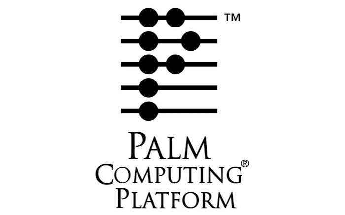

# Palm OS Developer Archive

  

**Preserving the tools, knowledge, and history of Palm OS development.**

A historical collection of Palm OS development resources, including SDKs, technical documentation, developer conference presentations, source code, utilities, examples, and other materials accumulated during the early years of mobile computing.

Much of this material has been sitting on hard drive backups for more than 25 years. Rather than allowing it to disappear into digital obscurity, I have decided to make it available to the community for historical preservation, research, and educational purposes.

Palm OS played an important role in the evolution of mobile computing, long before smartphones became ubiquitous. Its efficient architecture, compact applications, and innovative developer ecosystem demonstrated what could be accomplished with extremely limited hardware resources.

Today, there is renewed interest in preserving, emulating, and even reviving the platform. Hopefully, this archive can contribute something useful to those efforts.

## About This Archive

This repository contains approximately **1 GB of historical Palm OS development material**, collected over many years of working with the platform.

The archive includes a mixture of publicly distributed development resources, personal development material, technical references, and historical artifacts.

Where possible, files have been preserved in their original form rather than modified to accommodate modern development environments.

The intention is to retain not only the technical information but also a snapshot of the Palm OS development ecosystem as it existed at the time.

### What's Included

The collection contains material such as:

- **Software Development Kits (SDKs)** — Historical Palm OS development kits, headers, libraries, examples, and related development resources.
- **Technical Documentation** — Programming guides, API references, technical notes, specifications, and developer documentation.
- **Developer Conference Presentations** — Slides and technical presentations from Palm OS developer conferences and related industry events.
- **Palm OS Source Code** — Limited Release for PalmOS 3.5, 4.0 and 5.0.
- **Development Utilities** — Tools, scripts, converters, debugging aids, and other utilities used during Palm OS development.
- **Programming Examples** — Demonstrations of Palm OS APIs, graphics, databases, memory management, communication, and other platform capabilities.
- **Historical Material** — Additional files and resources that help document the development environment and ecosystem surrounding Palm OS.

Some material may be duplicated, incomplete, obsolete, or dependent on development environments that no longer exist. That is part of the nature of a historical archive.

### What's Not Included

To avoid distributing proprietary platform images and commercial applications, this repository intentionally excludes:

- Palm OS ROM images and firmware dumps.
- Commercial applications and games distributed without permission.
- Palm OS simulator and emulator binaries.
- Other material that I felt should not be redistributed publicly.

Developers interested in running Palm OS software should obtain the necessary system images and runtime environments from appropriately authorized sources.

## Historical Context

Palm OS emerged during a period when mobile computing was defined by severe hardware constraints.

Early devices operated with processors running at a fraction of today's clock speeds, memory measured in kilobytes or a few megabytes, and displays with extremely limited resolution and color capabilities. Despite those limitations, the platform supported a remarkable ecosystem of applications, games, productivity tools, and developer innovations.

Developers learned to work directly with the operating system, carefully manage memory, optimize graphics, minimize storage requirements, and extract maximum performance from constrained hardware. Many of the engineering principles involved remain relevant today, particularly in embedded systems, microcontrollers, and resource-constrained IoT devices. Preserving these materials provides an opportunity to study how those challenges were approached and solved.

## A Personal Connection

My involvement with Palm OS goes back to the early days of the platform, when developing software for handheld devices required a very different mindset from modern application development.

Over the years, I worked on applications, games, low-level programming techniques, development tools, and experiments that explored the capabilities and limitations of the platform. Some of that work involved pushing Palm OS hardware well beyond its intended use, including emulation, graphics programming, and performance optimization. The files in this repository were collected during that period, alongside resources obtained through the wider Palm OS developer community.

For me, this archive is both a technical resource and a personal reminder of an important period in computing history. It is also a way to give something back to a community that continues to appreciate the ingenuity of these early mobile systems.

## Using the Archive

This repository is primarily intended for:

- **Historical preservation** — Keeping early mobile development resources accessible.
- **Education** — Understanding Palm OS architecture, APIs, programming models, and resource constraints.
- **Research** — Studying the evolution of handheld computing and mobile software development.
- **Retrocomputing** — Supporting enthusiasts working with original Palm OS hardware.
- **Emulation and revival projects** — Providing technical references that may help modern efforts to reproduce or extend Palm OS functionality.

Not all resources will work with current operating systems or development tools.

Some utilities may require legacy versions of Windows, classic Mac OS, or historical development environments. Others may depend on hardware or software that is no longer readily available. No guarantee is made that any particular tool, example, or SDK remains functional.

## Archive Organization

The collection is organized around the original development resources and their historical context.

Where practical, directories and filenames are preserved to retain compatibility with old documentation, build scripts, and development workflows. The structure may evolve as material is catalogued, duplicates are identified, and additional historical resources are recovered. The objective is preservation first, modernization second.

## Copyright and Licensing

**This repository is a historical archive, not a declaration that all included material is open source or in the public domain.**

The collection contains resources originating from different individuals, companies, organizations, and developer communities. Unless explicitly stated otherwise:

- Copyright remains with the respective original authors and rights holders.
- Original license terms, where available, continue to apply.
- Inclusion in this archive does not grant additional rights to redistribute, modify, or commercially exploit the material.
- Material is provided for historical reference, research, and educational purposes, subject to applicable copyright law.

Any source code for which I personally hold the necessary rights may be made available under a separate license, identified alongside the relevant files. If you are a copyright holder and believe material has been included that should not be publicly distributed, please open a GitHub issue identifying the relevant files. Legitimate concerns will be reviewed, and material can be removed where appropriate.

## Contributions

Contributions are welcome, particularly those that help improve the historical and technical value of the archive. Useful contributions might include:

- Identifying missing documentation or original authors.
- Providing historical context for development tools and presentations.
- Correcting filenames, dates, or descriptions.
- Documenting how legacy utilities can be used on modern systems.
- Identifying duplicate or corrupted files.
- Contributing links to related preservation and revival projects.
- Submitting additional material where redistribution rights are clear.

Please avoid submitting copyrighted commercial software, ROM images, or other material without appropriate redistribution permission. The intention is to maintain a useful and responsible historical resource.

## Disclaimer

All materials are provided **as-is**, without warranty of any kind.

Many of the files are decades old, and some may contain bugs, security vulnerabilities, unsupported dependencies, or assumptions that no longer apply to modern computing environments. Exercise appropriate caution when running historical executables or development utilities.

This archive is an independent preservation effort and is not affiliated with, endorsed by, or officially supported by Palm, PalmSource, ACCESS, or any other former Palm OS platform owner.

All trademarks and product names remain the property of their respective owners.

## Final Thoughts

The history of computing is not only written by the companies that created the hardware and operating systems. It is also written by the developers who experimented with them, built applications, shared knowledge, and discovered what was possible.

Palm OS represents an era when a small amount of memory, a modest processor, and a clever piece of code could produce something remarkable. Much of that knowledge now exists only in aging backups, forgotten websites, archived mailing lists, and personal collections. If even a small part of this archive helps someone understand the platform, recover a forgotten technique, restore an old application, or build something new, then preserving it will have been worthwhile.

**Keep the history alive.**

## About the Author

This archive is maintained by **Aaron Ardiri**, a software engineer, technology entrepreneur, and author whose work spans early handheld computing, mobile platforms, embedded systems, and software architecture.

Having previously released source code from his Palm OS and VTOS development projects, this archive represents a further effort to preserve the tools, knowledge, and technical history of that era.

Aaron is also the author of **Technology, Entrepreneurship and the Reality of Building Systems** and a few titles that explores the history of computing, the engineering behind modern technology, and the practical realities of building software and hardware systems.

**Books, publications, and more:** [www.ardiri.com](https://www.ardiri.com)

---

*Collected and preserved by Aaron Ardiri.*

*Originally accumulated during the Palm OS development era and made available for historical preservation and educational reference.*
