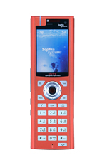

# SandgateVP Linux Package

**Document:** BDT023AL  
**Date:** 2006-12-01

*Concept Model for a hybrid cellular phone fusing WiFi and mobile communication*

## SandgateVP Linux Package Files List

### Hardware Spec

- [Hardware Spec Manual](SandgateVP_Hardware_Spec.pdf) (PDF)

### Operation Manual

- [SandgateVP Operation Manual](SGVP_Linux_Operation_Manual.pdf) (PDF)

### Linux

- [Linux Folder Configuration](Linux/Readme.txt)
- [Linux Installation Handbook](Linux/document/SGVP_Linux_Manual.pdf) (PDF)
- [Software User Agreement](Linux/SGVP_Software_User_Agreement.pdf) (PDF)

### Debug Environment Setup

- [ICE Connection Method](Setup/SGVP_and_ICE_Connection_Method.pdf) (PDF)
- [Serial Kit Connection Method](Setup/SGVP_Serial_Kit_Connection_Method.pdf) (PDF)

## Additional Information

Production information updates were originally available on the [Sophia Systems website](http://www.sophia-systems.co.jp/ice/intel/pxa27x/sgvp/index.html).

Adobe Acrobat is a trademark of Adobe Systems Incorporated.

